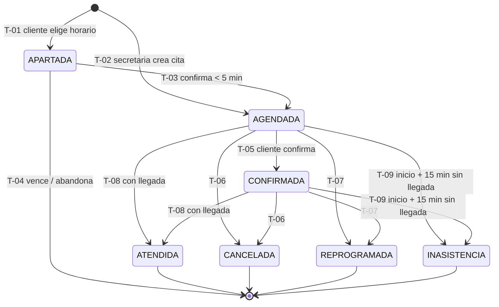

# architecture-spec — Sistema Web de Citas para Veterinaria

> **Rol de este archivo:** documento base. `feature-core-01.md`, `feature-core-02.md` y `ui-ux-spec.md` usan los IDs definidos aquí (entidades, estados, `RN-xx`, `RG-xx`, códigos de error) y **no los redefinen**. Si hay contradicción entre archivos, prevalece este.
>
> **Origen:** `01-PRD.md` — sec. 3 (alcance), 4 (reglas `RN-01…RN-10`), 5 (`RF-01…RF-12`, `RNF-01…RNF-06`) y 7 (aceptación).
>
> **Prefijos:** `RN` = regla del PRD · `RG` = regla global de especificación (resuelve lo que el PRD dejaba abierto o implícito) · `EC` = caso borde · `AC` = criterio de aceptación · `T` = transición de estado · `J` = tarea programada.

---

## 1. Stack tecnológico sugerido

| Capa | Tecnología | Motivo / trazabilidad |
|---|---|---|
| Frontend | React 18 + TypeScript + Vite, Tailwind CSS, React Router, TanStack Query, date-fns + date-fns-tz | RNF-03 (web adaptada a celular, *mobile-first*). TanStack Query facilita los estados cargando / error / vacío. |
| Backend | Node.js 20 LTS + TypeScript + Fastify, validación con Zod | API REST JSON; bajo consumo de recursos (restricción de hosting económico). |
| Base de datos | PostgreSQL 16 | RNF-02 / RN-01 / RF-05: transacciones y restricción de exclusión `gist` impiden choques. |
| Tiempo real | Server-Sent Events (SSE) | RNF-02: cambios visibles en < 5 s sin recargar. Más simple que WebSocket. |
| Tareas programadas | `node-cron` dentro del proceso del backend (1 instancia) | Liberar apartados, recordatorios, inasistencias (sección 5.6). |
| Correo | SMTP de proveedor transaccional vía `nodemailer` | RF-07 (confirmaciones y recordatorios). Canal único en v1 (RG-07). |
| Seguridad | `argon2id` para contraseñas, HTTPS/TLS, cookie de sesión `httpOnly` + `Secure` + `SameSite=Lax` | RNF-04. |
| Hosting | 1 VPS o PaaS económico (≈1 vCPU / 1–2 GB RAM) con PostgreSQL | Restricción de presupuesto y equipos existentes. |
| Prototipo visual | Frontend con estado simulado en memoria (sin backend ni persistencia) generado por herramienta de IA | Debe respetar reglas, estados, mensajes y datos semilla de estos specs (sección 3.5). |

### Disponibilidad (RNF-05)

Objetivo del PRD: 99 % de disponibilidad durante el horario de atención. Con el horario semilla (49 h por semana) equivale a ≈ 29 min de caída tolerada por semana.

El sistema corre en **una sola instancia** (1 VPS, 1 proceso con `node-cron`, 1 base de datos). **Se acepta ese riesgo** por la restricción de presupuesto del PRD: no hay redundancia ni conmutación por falla, y una falla de hardware del VPS implica indisponibilidad hasta restaurar el respaldo. Se reduce con:

| Medida | Efecto |
|---|---|
| Reinicio automático del proceso (systemd o PM2) | Una caída del proceso se recupera en segundos |
| Despliegues y mantenimiento fuera del horario de atención | No consumen el 1 % tolerado |
| Respaldo diario de PostgreSQL con prueba de restauración | Límite de pérdida de datos y de tiempo de recuperación |
| Monitoreo externo de la URL con aviso al administrador | La caída se detecta sin esperar reportes de usuarios |
| Tareas J-01…J-04 idempotentes que se ponen al día al arrancar | Un reinicio no pierde inasistencias ni recordatorios (AC-ARQ-16) |

---

## 2. Convenciones globales

- **Idioma de la UI:** español (Costa Rica). Nombres de campos, enums y códigos de error exactamente como se escriben en este documento.
- **IDs:** UUID v4.
- **Zona horaria:** `America/Costa_Rica` (UTC−6, sin horario de verano). En BD: `timestamptz` (UTC). En la API: ISO 8601 con offset, ej. `2026-12-08T10:00:00-06:00`. "Día" = fecha calendario en `America/Costa_Rica` (ver RG-01).
- **Formato en UI:** fecha `DD/MM/YYYY`; hora 12 h `h:mm a. m.` / `h:mm p. m.`; teléfono `XXXX-XXXX`.
- **Intervalos semiabiertos `[inicio, fin)`:** dos intervalos chocan si `A.inicio < B.fin AND B.inicio < A.fin`. Citas consecutivas (`fin` de una = `inicio` de la siguiente) **no** chocan.
- **Paginación:** query `pagina` (default 1) y `por_pagina` (default 20, máx. 50). Respuesta `{ "items": [...], "total": n, "pagina": n, "por_pagina": n }`.
- **Formato de error (todas las rutas):**

```json
{ "error": { "codigo": "HORARIO_NO_DISPONIBLE", "mensaje": "texto técnico", "detalles": { } } }
```

---

## 3. Modelo de datos

### 3.1 Relaciones

```
Usuario 1──0..1 Cliente        (Cliente.usuario_id; NULL si lo registró recepción)
Usuario 1──0..1 Veterinario    (rol VETERINARIO)
Cliente 1──* Mascota
Mascota 1──* Cita
Veterinario 1──* Cita
Servicio 1──* Cita
Veterinario 1──* Turno
Veterinario 0..1──* DiaNoLaborable   (NULL = feriado general)
Veterinario 1──* Bloqueo
Cita 0..1──* Cita              (Cita.cita_origen_id: reprogramación)
Cita 1──* Notificacion
```

### 3.2 Entidades

**Usuario**

| Campo | Tipo | Req. | Restricciones |
|---|---|---|---|
| id | UUID | sí | PK |
| correo | string | sí | 5–254, formato email, único sin distinguir mayúsculas |
| contrasena_hash | string | sí | argon2id |
| rol | enum | sí | `CLIENTE` \| `SECRETARIA` \| `VETERINARIO` \| `ADMINISTRADOR` |
| nombre_completo | string | sí | 2–100 |
| activo | boolean | sí | default `true` |
| creado_en | timestamptz | sí | |

**Cliente**

| Campo | Tipo | Req. | Restricciones |
|---|---|---|---|
| id | UUID | sí | PK |
| usuario_id | UUID | no | FK→Usuario, único. `NULL` = cliente registrado por recepción, sin cuenta (RG-18) |
| nombre_completo | string | sí | 2–100 |
| telefono | string | sí | 8 dígitos `^[0-9]{8}$` |
| correo | string | no | ≤254. Obligatorio si `usuario_id` no es NULL (igual a `Usuario.correo`). Único sin distinguir mayúsculas cuando no es NULL (RG-19) |
| creado_en | timestamptz | sí | |

**Mascota**

| Campo | Tipo | Req. | Restricciones |
|---|---|---|---|
| id | UUID | sí | PK |
| cliente_id | UUID | sí | FK→Cliente |
| nombre | string | sí | 1–50 |
| especie | enum | sí | `PERRO` \| `GATO` \| `AVE` \| `ROEDOR` \| `OTRO` |
| raza | string | no | 0–50 |
| edad_anios | integer | sí | 0–40 (`0` = menos de 1 año) |
| creada_en | timestamptz | sí | |

**Servicio**

| Campo | Tipo | Req. | Restricciones |
|---|---|---|---|
| id | UUID | sí | PK |
| nombre | string | sí | 2–60, único |
| duracion_min | integer | sí | 15–480, múltiplo de 15 (RG-02) |
| activo | boolean | sí | default `true` |

**Veterinario**

| Campo | Tipo | Req. | Restricciones |
|---|---|---|---|
| id | UUID | sí | PK |
| usuario_id | UUID | sí | FK→Usuario (rol `VETERINARIO`), único |
| activo | boolean | sí | default `true` |
| creado_en | timestamptz | sí | |

**HorarioAtencion** (horario general de la veterinaria; una fila por día abierto, día sin fila = cerrado)

| Campo | Tipo | Req. | Restricciones |
|---|---|---|---|
| id | UUID | sí | PK |
| dia_semana | integer | sí | 1–7 (1 = lunes … 7 = domingo), único |
| hora_apertura | time | sí | múltiplo de 15 min |
| hora_cierre | time | sí | `> hora_apertura`, múltiplo de 15 min, mismo día |

**Turno** (horas en que atiende un veterinario)

| Campo | Tipo | Req. | Restricciones |
|---|---|---|---|
| id | UUID | sí | PK |
| veterinario_id | UUID | sí | FK→Veterinario |
| dia_semana | integer | sí | 1–7 |
| hora_inicio | time | sí | múltiplo de 15 min |
| hora_fin | time | sí | `> hora_inicio`, múltiplo de 15 min |

Regla: los turnos de un mismo veterinario y día **no se solapan**. Se permiten varios turnos por día (turno partido).

**DiaNoLaborable**

| Campo | Tipo | Req. | Restricciones |
|---|---|---|---|
| id | UUID | sí | PK |
| tipo | enum | sí | `FERIADO` (aplica a todos) \| `DIA_LIBRE` (de un veterinario) |
| fecha | date | sí | |
| veterinario_id | UUID | cond. | `NULL` si `FERIADO`; obligatorio si `DIA_LIBRE` |
| motivo | string | no | 0–100 |

Único por (`tipo`, `fecha`, `veterinario_id`).

**Cita**

| Campo | Tipo | Req. | Restricciones |
|---|---|---|---|
| id | UUID | sí | PK |
| mascota_id | UUID | sí | FK→Mascota |
| veterinario_id | UUID | sí | FK→Veterinario (siempre asignado, incluso en `APARTADA`) |
| servicio_id | UUID | sí | FK→Servicio |
| inicio | timestamptz | sí | minutos ∈ {0,15,30,45}, segundos = 0 |
| fin | timestamptz | sí | `inicio + duración del servicio` **al momento de crearla** (RN-02). Cambios posteriores de duración no la alteran |
| estado | enum | sí | `APARTADA` \| `AGENDADA` \| `CONFIRMADA` \| `ATENDIDA` \| `CANCELADA` \| `REPROGRAMADA` \| `INASISTENCIA` |
| canal | enum | sí | `WEB` \| `TELEFONO` \| `PRESENCIAL` |
| motivo | string | no | 0–500 |
| apartada_hasta | timestamptz | cond. | Solo si `estado = APARTADA` (= creación + 5 min, RN-04); `NULL` en los demás |
| cita_origen_id | UUID | no | FK→Cita. Solo en citas nacidas de una reprogramación (RG-12) |
| creada_por_usuario_id | UUID | sí | FK→Usuario |
| creada_en | timestamptz | sí | |
| agendada_en | timestamptz | no | Momento en que pasó a `AGENDADA` |
| llegada_en | timestamptz | no | Momento en que recepción registró la llegada (RG-13) |
| actualizada_en | timestamptz | sí | |

**Bloqueo** (RN-08)

| Campo | Tipo | Req. | Restricciones |
|---|---|---|---|
| id | UUID | sí | PK |
| veterinario_id | UUID | sí | FK→Veterinario |
| inicio | timestamptz | sí | múltiplo de 15 min |
| fin | timestamptz | sí | `> inicio`, múltiplo de 15 min, mismo día calendario |
| motivo | string | no | 0–100 |
| creado_por_usuario_id | UUID | sí | FK→Usuario (rol `SECRETARIA`) |
| creado_en | timestamptz | sí | |

**Notificacion**

| Campo | Tipo | Req. | Restricciones |
|---|---|---|---|
| id | UUID | sí | PK |
| cita_id | UUID | sí | FK→Cita |
| tipo | enum | sí | `CONFIRMACION` \| `RECORDATORIO` |
| destinatario_correo | string | sí | |
| estado | enum | sí | `PENDIENTE` \| `ENVIADA` \| `FALLIDA` |
| intentos | integer | sí | default 0, máx. 3 |
| proximo_intento_en | timestamptz | no | |
| enviada_en | timestamptz | no | |
| creada_en | timestamptz | sí | |

Única por (`cita_id`, `tipo`) → el envío es idempotente.

### 3.3 Restricciones de base de datos

1. **Exclusión de choques (RN-01, RF-05, RNF-02):**
   `EXCLUDE USING gist (veterinario_id WITH =, tstzrange(inicio, fin, '[)') WITH &&) WHERE (estado NOT IN ('CANCELADA','REPROGRAMADA','INASISTENCIA') AND NOT (estado = 'APARTADA' AND cita_origen_id IS NOT NULL))`
   Los apartados de una reprogramación (`APARTADA` con `cita_origen_id`) quedan fuera de la restricción porque pueden solaparse con la propia cita original (ej. mover 10:00 → 10:15); su exclusividad la garantiza la validación bajo bloqueo (§5.4). Al pasar a `AGENDADA` la restricción sí aplica, por eso el original se marca `REPROGRAMADA` **antes** (RG-12).
2. `CHECK ((estado = 'APARTADA') = (apartada_hasta IS NOT NULL))`.
3. `CHECK (fin > inicio)` en `Cita` y `Bloqueo`.
4. Índice único `lower(Usuario.correo)`.
5. Único parcial `Cliente.usuario_id WHERE usuario_id IS NOT NULL`.
6. Único `lower(Cliente.correo) WHERE correo IS NOT NULL` (RG-19).

### 3.4 Parámetros del sistema (constantes de configuración, no editables desde la UI)

| Constante | Valor | Origen |
|---|---|---|
| `APARTADO_MINUTOS` | 5 | RN-04 |
| `ANTICIPACION_MIN_ONLINE_HORAS` | 2 | RN-05 |
| `PLAZO_CLIENTE_HORAS` | 4 | RN-06 |
| `MAX_CITAS_ACTIVAS_POR_MASCOTA` | 2 | RN-07 |
| `TOLERANCIA_INASISTENCIA_MIN` | 15 | RN-09 |
| `RECORDATORIO_HORAS_ANTES` | 24 | RF-07 |
| `GRANULARIDAD_MIN` | 15 | RG-02 |
| `VENTANA_AGENDAMIENTO_DIAS` | 60 | RG-03 |

### 3.5 Datos semilla (solo para el prototipo y las pruebas)

| Entidad | Datos |
|---|---|
| HorarioAtencion | Lun–Vie 08:00–17:00 · Sáb 08:00–12:00 · Domingo cerrado |
| Servicio | Consulta 30 min · Vacunación 15 min · Baño 45 min · Cirugía programada 120 min |
| Veterinario | **Dra. María Solís** (Lun–Vie 08:00–16:00) · **Dr. Andrés Vargas** (Lun–Vie 10:00–17:00 y Sáb 08:00–12:00) |
| Cliente | Ana Rodríguez · 8888-1234 · ana@correo.com (con cuenta) |
| Mascota | Luna (PERRO, Labrador, 3 años) · Miso (GATO, 2 años), ambas de Ana |
| Cuentas staff | 1 SECRETARIA, 1 ADMINISTRADOR |
| DiaNoLaborable | 1 `FERIADO` futuro de ejemplo |
| Cita | Varias citas en estados distintos (`AGENDADA`, `CONFIRMADA`, `ATENDIDA`, `CANCELADA`, `INASISTENCIA`) y 1 `Bloqueo`, para que cada pantalla tenga contenido |

### 3.6 Contratos de datos transversales

**Objeto `CitaDetalle`** (representación de una cita en la API; lo usan `feature-core-01`, `feature-core-02` y la UI):

```json
{
  "id": "uuid",
  "estado": "AGENDADA",
  "canal": "WEB",
  "inicio": "2026-12-08T10:00:00-06:00",
  "fin": "2026-12-08T10:30:00-06:00",
  "motivo": "Vómito desde ayer",
  "llegada_en": null,
  "cita_origen_id": null,
  "apartada_hasta": null,
  "servicio":    { "id": "uuid", "nombre": "Consulta", "duracion_min": 30 },
  "mascota":     { "id": "uuid", "nombre": "Luna", "especie": "PERRO", "raza": "Labrador", "edad_anios": 3 },
  "veterinario": { "id": "uuid", "nombre_completo": "Dra. María Solís" },
  "cliente":     { "id": "uuid", "nombre_completo": "Ana Rodríguez", "telefono": "88881234", "correo": "ana@correo.com" },
  "acciones_permitidas": {
    "confirmar": false, "reprogramar": true, "cancelar": true,
    "registrar_llegada": false, "marcar_atendida": false
  }
}
```

- `cliente` se incluye **solo** para rol `SECRETARIA` (RG-17). `apartada_hasta` solo si `estado = APARTADA`.
- `acciones_permitidas` lo calcula el servidor según rol, estado y hora (reglas en `feature-core-02.md` §3). **La UI no recalcula plazos: solo lee estos booleanos.**

**Endpoints transversales** (los de disponibilidad, citas, agenda y bloqueos están en `feature-core-01.md` y `feature-core-02.md`):

| Método y ruta | Rol | Entrada | Éxito | Errores |
|---|---|---|---|---|
| `POST /api/auth/registro` (RF-01) | público | `{nombre_completo, correo, telefono, contrasena, acepta_datos}` | 201 `{usuario:{id,rol,nombre_completo}, cliente:{id}}` + cookie de sesión. Si hay un Cliente sin cuenta con ese correo, `cliente.id` es el existente (RG-19) | `VALIDACION`, `CORREO_DUPLICADO` |
| `POST /api/auth/login` | público | `{correo, contrasena}` | 200 `{usuario}` + cookie | `CREDENCIALES_INVALIDAS` |
| `POST /api/auth/logout` | autenticado | — | 204 | — |
| `GET /api/auth/yo` | autenticado | — | 200 `{usuario, cliente?, veterinario?}` | `NO_AUTENTICADO` |
| `GET /api/mascotas` | CLIENTE | — | 200 `{items:[{id,nombre,especie,raza,edad_anios,citas_activas}]}` | — |
| `POST /api/mascotas` | CLIENTE | `{nombre, especie, raza?, edad_anios}` | 201 Mascota | `VALIDACION` |
| `PUT /api/mascotas/{id}` | CLIENTE (propia) | mismos campos | 200 Mascota | `VALIDACION`, `RECURSO_NO_ENCONTRADO` |
| `GET /api/clientes?q=` | SECRETARIA | `q` ≥ 2 caracteres (nombre, teléfono o correo) | 200 `{items:[{id,nombre_completo,telefono,correo,mascotas:[…]}]}` (máx. 10) | `VALIDACION` |
| `POST /api/clientes` | SECRETARIA | `{nombre_completo, telefono, correo?}` | 201 Cliente (`usuario_id = NULL`) | `VALIDACION`, `CORREO_DUPLICADO` (con `detalles.cliente_id`) |
| `POST /api/clientes/{id}/mascotas` | SECRETARIA | campos de Mascota | 201 Mascota | `VALIDACION`, `RECURSO_NO_ENCONTRADO` |
| `GET /api/mascotas/{id}/historial` (RF-11) | CLIENTE (propia) / SECRETARIA | `pagina`, `por_pagina` | 200 `{items:[{cita_id,inicio,servicio,veterinario,estado,motivo}], total}` ordenado por `inicio` desc | `RECURSO_NO_ENCONTRADO` |
| `GET /api/servicios` | autenticado | — | 200 lista (CLIENTE y SECRETARIA solo ven `activo = true`) | — |
| `POST /api/servicios`, `PUT /api/servicios/{id}` (RF-08) | ADMINISTRADOR | `{nombre, duracion_min, activo}` | 201 / 200 Servicio | `VALIDACION`, `SIN_PERMISO` |
| `GET /api/veterinarios` | autenticado | — | 200 `[{id,nombre_completo,activo}]` (CLIENTE/SECRETARIA solo activos) | — |
| `POST /api/veterinarios` (RF-08) | ADMINISTRADOR | `{nombre_completo, correo, contrasena, activo}` (crea Usuario + Veterinario) | 201 | `VALIDACION`, `CORREO_DUPLICADO` |
| `PUT /api/veterinarios/{id}` | ADMINISTRADOR | `{nombre_completo, activo}` | 200 | `CONFIGURACION_CON_CITAS` (al desactivar con citas futuras) |
| `PUT /api/veterinarios/{id}/turnos` | ADMINISTRADOR | `{turnos:[{dia_semana,hora_inicio,hora_fin}]}` (reemplaza todos) | 200 | `VALIDACION` (turnos solapados) |
| `GET /api/horario-atencion` / `PUT /api/horario-atencion` | autenticado / ADMINISTRADOR | `{dias:[{dia_semana,hora_apertura,hora_cierre}]}` (reemplaza todos) | 200 | `VALIDACION` |
| `GET /api/dias-no-laborables` / `POST` / `DELETE /{id}` | autenticado / ADMINISTRADOR | `{tipo, fecha, veterinario_id?, motivo?}` | 200 / 201 / 204 | `VALIDACION`, `CONFIGURACION_CON_CITAS` |
| `GET /api/reportes/citas` (RF-12) | ADMINISTRADOR | `desde`, `hasta` (fechas), `agrupar_por` ∈ `dia`\|`servicio`\|`veterinario`\|`canal` | ver abajo | `VALIDACION` |

**Respuesta de `GET /api/reportes/citas`:**

```json
{
  "resumen": { "total": 40, "atendidas": 28, "inasistencias": 4, "canceladas": 8,
               "tasa_inasistencia": 12.5, "porcentaje_en_linea": 55.0 },
  "filas": [ { "clave": "2026-12-08", "etiqueta": "08/12/2026", "total": 6, "atendidas": 5, "inasistencias": 1, "canceladas": 0 } ]
}
```

Definiciones: `total` = citas con estado distinto de `APARTADA` y `REPROGRAMADA`, con `inicio` dentro de `[desde, hasta]`. `tasa_inasistencia` = `INASISTENCIA / (ATENDIDA + INASISTENCIA) × 100`, 1 decimal (`null` si el denominador es 0). `porcentaje_en_linea` = citas `WEB` / `total × 100`, 1 decimal.

---

## 4. Ciclo de vida de la Cita

### 4.1 Estados

| Estado | Etiqueta UI | Ocupa horario (RG-05) | Cuenta para RN-07 (RG-04) | Terminal |
|---|---|---|---|---|
| `APARTADA` | Apartada | sí | sí | no (temporal, 5 min) |
| `AGENDADA` | Agendada | sí | sí | no |
| `CONFIRMADA` | Confirmada | sí | sí | no |
| `ATENDIDA` | Atendida | sí | no | sí |
| `CANCELADA` | Cancelada | **no** | no | sí |
| `REPROGRAMADA` | Reprogramada | **no** | no | sí |
| `INASISTENCIA` | Inasistencia | **no** | no | sí |

### 4.2 Transiciones

| ID | Desde → Hacia | Evento / actor | Guardas |
|---|---|---|---|
| T-01 | ∅ → `APARTADA` | Cliente elige un horario en línea | RN-03, RN-05, RN-07, RN-01, ventana (RG-03) |
| T-02 | ∅ → `AGENDADA` | Secretaria crea cita (canal `TELEFONO`/`PRESENCIAL`) | RN-03, RN-07, RN-01, `inicio ≥ ahora` |
| T-03 | `APARTADA` → `AGENDADA` | Cliente confirma | `apartada_hasta > ahora` |
| T-04 | `APARTADA` → *(se elimina el registro)* | Vence `apartada_hasta` (J-01), el cliente abandona o se crea otro apartado del mismo cliente (RG-11) | — |
| T-05 | `AGENDADA` → `CONFIRMADA` | Cliente confirma asistencia | `ahora < inicio` |
| T-06 | `AGENDADA`\|`CONFIRMADA` → `CANCELADA` | Cliente o Secretaria | `llegada_en` es NULL. Cliente: además `inicio − ahora ≥ 4 h` (RN-06) |
| T-07 | `AGENDADA`\|`CONFIRMADA` → `REPROGRAMADA` | Cliente o Secretaria | Mismas guardas que T-06 + el nuevo horario cumple T-01 (cliente) o T-02 (secretaria). Se crea una **nueva** Cita (RG-12) |
| T-08 | `AGENDADA`\|`CONFIRMADA` → `ATENDIDA` | Veterinario asignado | `llegada_en` NO es NULL |
| T-09 | `AGENDADA`\|`CONFIRMADA` → `INASISTENCIA` | Sistema (J-03) | `llegada_en` es NULL y `ahora ≥ inicio + 15 min` (RN-09) |

Notas:
- **Registrar la llegada no es una transición**: solo asigna `llegada_en` (RG-13).
- Al pasar a `INASISTENCIA` el horario se libera (RG-05).
- En la reprogramación web, T-07 del original ocurre en la misma transacción que T-03 de la nueva cita; en recepción, en la misma transacción que T-02.
- Cualquier otra combinación de (estado, acción) responde `TRANSICION_INVALIDA`.



---

## 5. Reglas globales

### 5.1 Reglas de negocio del PRD (valores concretos)

| ID | Regla | Se aplica a | Especificada en |
|---|---|---|---|
| RN-01 | Un horario de un veterinario no admite dos citas; se valida al guardar | Todos los canales | §5.4, core-01 |
| RN-02 | La cita ocupa `duracion_min` completo del servicio | Todos | §3.2 (`fin`), core-01 |
| RN-03 | Solo se ofrecen horarios dentro de `HorarioAtencion` ∩ `Turno` del veterinario, excluyendo `FERIADO` y `DIA_LIBRE` | Todos | core-01 §4 |
| RN-04 | Apartado de 5 min al escoger horario en línea | `WEB` | core-01 §5 |
| RN-05 | Citas en línea con ≥ 2 h de anticipación | Solo rol `CLIENTE` | core-01 §5 |
| RN-06 | Cliente cancela/reprograma hasta 4 h antes; después, solo recepción | Solo rol `CLIENTE` | core-02 |
| RN-07 | Máx. 2 citas activas por mascota (estados de RG-04) | Todos los canales | core-01, core-02 |
| RN-08 | Secretarias bloquean horarios; dejan de mostrarse en la web | `SECRETARIA` | core-01 §7 |
| RN-09 | Sin llegada 15 min después de la hora → `INASISTENCIA` | Sistema | core-02 |
| RN-10 | Solo el administrador cambia servicios, duraciones y horarios de atención | `ADMINISTRADOR` | §5.3 |

### 5.2 Reglas globales de especificación

| ID | Regla |
|---|---|
| RG-01 | Todo cálculo de plazos, fechas y "hoy" se hace **en el servidor** en `America/Costa_Rica`. La UI nunca decide si un plazo se cumplió. |
| RG-02 | Cuadrícula de 15 min: los `inicio` de cita, bloqueo, turnos y horarios son múltiplos de 15 min; las duraciones son múltiplos de 15 min. |
| RG-03 | El rol `CLIENTE` solo agenda hasta 60 días después de hoy (inclusive). `SECRETARIA` no tiene límite superior. |
| RG-04 | RN-07 cuenta citas de la mascota en `APARTADA`, `AGENDADA` o `CONFIRMADA`. |
| RG-05 | Una cita **ocupa horario** en todos los estados excepto `CANCELADA`, `REPROGRAMADA` e `INASISTENCIA`. Al marcar la inasistencia el bloque queda libre para otra cita; la cita sigue en el historial y en los reportes. |
| RG-06 | Si el cliente no escoge veterinario, el sistema asigna entre los veterinarios activos con el horario libre: el de **menos citas que ocupan horario ese día**; en empate, el de menor `Veterinario.creado_en`. La asignación ocurre al crear el apartado y se muestra al cliente antes de confirmar. |
| RG-07 | En v1 las confirmaciones y recordatorios se envían **solo por correo electrónico** (resuelve pregunta abierta del PRD). El recordatorio se envía solo a citas `AGENDADA` (no a `CONFIRMADA`). Queda **fuera de alcance** enviar correo al cancelar; al reprogramar solo se envía la confirmación de la cita nueva (RF-07 cubre confirmación y recordatorio). |
| RG-08 | El veterinario es **opcional** para el `CLIENTE` (RG-06) y **obligatorio** para la `SECRETARIA` (resuelve pregunta abierta del PRD). |
| RG-09 | No hay depósitos ni cobros en ninguna cita (resuelve pregunta abierta del PRD; coherente con la exclusión de pagos). |
| RG-10 | Cualquier veterinario activo puede atender cualquier servicio activo. |
| RG-11 | Un cliente tiene como máximo **un apartado vigente**. Al crear uno nuevo se elimina el anterior en la misma transacción. |
| RG-12 | Reprogramar conserva mascota y servicio. Se crea una Cita nueva con `cita_origen_id`, mismo `canal` que el original, nacida `AGENDADA` (pierde la confirmación). En **una sola transacción y en este orden**: (1) el original pasa a `REPROGRAMADA`; (2) la nueva se inserta `AGENDADA` (recepción) o pasa de `APARTADA` a `AGENDADA` (web). Así se puede mover una cita a un horario que solapa con el suyo (ej. 10:00 → 10:15). Si algún paso falla se revierte todo y el original no cambia. |
| RG-13 | Registrar llegada asigna `llegada_en` y no cambia el estado. `ATENDIDA` exige `llegada_en`. |
| RG-14 | Las cuentas `SECRETARIA` y `ADMINISTRADOR` se crean como datos iniciales (no hay pantallas para gestionarlas). El administrador crea los veterinarios (RF-08). |
| RG-15 | Contraseña: 8–64 caracteres, al menos 1 letra y 1 número. La sesión expira a las 8 h. |
| RG-16 | El registro exige aceptar el tratamiento de datos personales (Ley 8968): `acepta_datos = true`. |
| RG-17 | Visibilidad (RNF-06): el cliente ve solo sus datos; el veterinario ve mascota y motivo pero **no** los datos del cliente; los clientes nunca reciben datos de otros clientes (ni por SSE). |
| RG-18 | Un cliente registrado por recepción no tiene cuenta (`usuario_id = NULL`); puede no tener correo, en cuyo caso no recibe notificaciones. |
| RG-19 | **Un solo `Cliente` por persona.** `Cliente.correo` es único. Al registrarse en línea, si existe un `Cliente` **sin cuenta** con el mismo correo (sin distinguir mayúsculas), no se crea otro: se vincula (`usuario_id` = la nueva cuenta), se actualizan `nombre_completo` y `telefono` con los datos del registro y se conservan sus mascotas y citas. Al crear un cliente por recepción con un correo que ya existe se rechaza con `CORREO_DUPLICADO` (`detalles.cliente_id`). No se verifica que el correo pertenezca a quien se registra (verificación de correo fuera del alcance del PRD). |

### 5.3 Permisos por rol

| Acción | CLIENTE | SECRETARIA | VETERINARIO | ADMINISTRADOR |
|---|---|---|---|---|
| Registrarse / iniciar sesión | público | público | público | público |
| Gestionar mascotas | propias | crear para cualquier cliente | — | — |
| Consultar disponibilidad | ✔ | ✔ | — | — |
| Apartar / agendar en línea | ✔ (mascotas propias) | — | — | — |
| Crear cita por teléfono / presencial | — | ✔ | — | — |
| Ver agenda | — | todos los veterinarios, día y semana | solo la propia, día | — |
| Ver datos del cliente en la cita | — | ✔ | **no** | — |
| Ver mascota y motivo de la cita | propia | ✔ | ✔ | — |
| Confirmar asistencia | propias | — | — | — |
| Cancelar / reprogramar | propias, hasta 4 h antes | siempre (sin llegada registrada) | — | — |
| Registrar llegada | — | ✔ | — | — |
| Marcar atendida | — | — | sus citas | — |
| Bloquear horarios | — | ✔ | — | — |
| Ver historial de mascota | propias | todas | — | — |
| Configurar servicios, horarios, veterinarios, días libres (RN-10) | — | — | — | ✔ |
| Ver reportes | — | — | — | ✔ |

Una acción sin permiso responde `SIN_PERMISO` (403). Un recurso ajeno al cliente responde `RECURSO_NO_ENCONTRADO` (404) para no revelar su existencia.

### 5.4 Concurrencia y atomicidad (RNF-02)

Toda operación que cree, mueva o elimine citas o bloqueos de un veterinario V corre en **una transacción** con este orden:

1. Bloquear la fila del veterinario: `SELECT … FROM veterinario WHERE id = V FOR UPDATE`. Si hay varios candidatos (RG-06), o si una reprogramación cambia de veterinario (se bloquean el del original y el de la nueva), bloquearlos en orden ascendente de `id` para evitar interbloqueos.
2. Eliminar los apartados vencidos (`estado = APARTADA AND apartada_hasta ≤ ahora`) de V que se solapen con el intervalo.
3. Validar RN-01 contra citas que ocupan horario (RG-05) y contra `Bloqueo`. En una reprogramación se ignora la cita original.
4. Escribir. En una reprogramación el orden de escritura es el de RG-12 (primero el original pasa a `REPROGRAMADA`).

La restricción de exclusión (§3.3) es la red de seguridad: si falla, la API responde `HORARIO_NO_DISPONIBLE`. Las transiciones de estado usan `UPDATE … WHERE estado IN (…esperados…)`; si afecta 0 filas responde `TRANSICION_INVALIDA`.

### 5.5 Tiempo real (RNF-02)

`GET /api/eventos` (autenticado, `text/event-stream`). Latido cada 25 s; `retry: 3000`. Si la conexión SSE falla 3 veces seguidas, el cliente web hace *polling* cada 5 s. Entrega máxima: 5 s (objetivo ≤ 1 s).

| Evento | Audiencia | Payload | Cuándo |
|---|---|---|---|
| `agenda.cambio` | SECRETARIA (todos los veterinarios); VETERINARIO (solo el suyo) | `{veterinario_id, fecha, tipo: "cita"\|"bloqueo", id, accion: "creada"\|"actualizada"\|"eliminada"}` | Cualquier cambio en una cita o bloqueo |
| `disponibilidad.cambio` | CLIENTE | `{veterinario_id, fecha}` | Cambia lo que ocupa horario. **Sin datos personales** (RG-17) |

### 5.6 Tareas programadas

| ID | Frecuencia | Acción |
|---|---|---|
| J-01 | cada 30 s | Eliminar apartados con `apartada_hasta ≤ ahora`; emitir `disponibilidad.cambio` |
| J-02 | cada 60 s | Crear y enviar recordatorios (reglas en `feature-core-02.md` §4.D) |
| J-03 | cada 60 s | Marcar `INASISTENCIA` (T-09) |
| J-04 | cada 60 s | Reintentar `Notificacion` `PENDIENTE` con `proximo_intento_en ≤ ahora`: máx. 3 intentos, 5 min entre intentos; al 3.er fallo pasa a `FALLIDA` y no afecta a la cita |

La corrección de la disponibilidad **no depende** de J-01: las consultas ignoran apartados vencidos (§5.4 paso 2).

### 5.7 Códigos de error estándar

| Código | HTTP | Cuándo |
|---|---|---|
| `VALIDACION` | 422 | Campo faltante o inválido. `detalles.campos = {campo: "mensaje"}` |
| `NO_AUTENTICADO` | 401 | Sin sesión válida |
| `SIN_PERMISO` | 403 | Rol sin permiso para la acción |
| `RECURSO_NO_ENCONTRADO` | 404 | No existe o no pertenece al solicitante |
| `CREDENCIALES_INVALIDAS` | 401 | Login incorrecto (mensaje genérico, no revela cuál campo falló) |
| `CORREO_DUPLICADO` | 409 | Correo ya registrado como cuenta o, al crear un cliente por recepción, como Cliente (`detalles.cliente_id`) |
| `HORARIO_NO_DISPONIBLE` | 409 | RN-01: el horario ya está ocupado o bloqueado |
| `FUERA_DE_HORARIO` | 422 | RN-03: fuera de atención/turno, feriado o día libre |
| `ANTICIPACION_INSUFICIENTE` | 422 | RN-05 |
| `VENTANA_EXCEDIDA` | 422 | RG-03 |
| `LIMITE_CITAS_MASCOTA` | 422 | RN-07. `detalles.mascota_id` |
| `APARTADO_EXPIRADO` | 410 | RN-04 |
| `PLAZO_VENCIDO` | 422 | RN-06 |
| `TRANSICION_INVALIDA` | 409 | Acción no válida para el estado actual. `detalles.estado_actual` |
| `BLOQUEO_CON_CITAS` | 409 | El bloqueo choca con citas/apartados. `detalles.citas = [ids]` |
| `BLOQUEO_SOLAPADO` | 409 | El bloqueo choca con otro bloqueo |
| `CONFIGURACION_CON_CITAS` | 409 | La configuración afecta citas futuras activas. `detalles.citas = [ids]` |

---

## 6. Casos borde

| ID | Caso | Comportamiento esperado |
|---|---|---|
| EC-ARQ-01 | Registro con correo que solo difiere en mayúsculas | `CORREO_DUPLICADO` (unicidad sin distinguir mayúsculas) |
| EC-ARQ-02 | Cliente creado por recepción sin correo | Se crea sin cuenta ni notificaciones (RG-18) |
| EC-ARQ-03 | El admin cambia la duración de un servicio con citas futuras | Las citas existentes conservan su `fin`; solo afecta las nuevas |
| EC-ARQ-04 | El admin desactiva un servicio con citas futuras | Permitido; las citas existentes siguen su curso; deja de ofrecerse |
| EC-ARQ-05 | El admin desactiva un veterinario con citas futuras activas | `CONFIGURACION_CON_CITAS` con los ids de las citas |
| EC-ARQ-06 | `DIA_LIBRE` o `FERIADO` sobre una fecha con citas activas | `CONFIGURACION_CON_CITAS`; recepción debe reprogramarlas antes |
| EC-ARQ-07 | El admin cambia turnos u horario de atención con citas futuras que quedan fuera | Permitido; las citas existentes **no** se modifican; solo cambia la oferta nueva |
| EC-ARQ-08 | Turnos solapados del mismo veterinario y día | `VALIDACION` |
| EC-ARQ-09 | Veterinario activo sin turnos configurados | No ofrece horarios |
| EC-ARQ-10 | Reloj del dispositivo del cliente desfasado | Sin efecto: plazos en servidor (RG-01); el temporizador usa `segundos_restantes` del servidor |
| EC-ARQ-11 | Se cae la conexión SSE | *Polling* cada 5 s tras 3 reintentos fallidos |
| EC-ARQ-12 | Dos cuentas con el mismo teléfono | Permitido (no es único); la búsqueda de clientes devuelve ambos |
| EC-ARQ-13 | Registro en línea con el correo de un Cliente creado por recepción | Se vincula al Cliente existente (RG-19); conserva mascotas e historial (AC-C1-20) |
| EC-ARQ-14 | Recepción crea un cliente con un correo que ya existe | 409 `CORREO_DUPLICADO` con `detalles.cliente_id` (AC-C1-21) |
| EC-ARQ-15 | El proceso del backend se cae y reinicia | J-01…J-04 retoman al arrancar y no duplican notificaciones (AC-ARQ-16) |

---

## 7. Criterios de aceptación

**AC-ARQ-01 — Registro (RF-01)**
**Given** no existe cuenta con `ana@correo.com` **When** se envía un registro válido con `acepta_datos = true` **Then** responde 201, el rol es `CLIENTE`, se inicia sesión y la contraseña se almacena solo como hash `argon2id`.

**AC-ARQ-02 — Consentimiento (RG-16)**
**Given** un registro con `acepta_datos = false` **When** se envía **Then** responde 422 `VALIDACION` en el campo `acepta_datos` y no se crea la cuenta.

**AC-ARQ-03 — Correo duplicado**
**Given** existe la cuenta `Ana@Correo.com` **When** alguien registra `ana@correo.com` **Then** responde 409 `CORREO_DUPLICADO`.

**AC-ARQ-04 — Permisos (RNF-04)**
**Given** una sesión con rol `CLIENTE` **When** pide `GET /api/agenda` **Then** responde 403 `SIN_PERMISO`.

**AC-ARQ-05 — Privacidad (RNF-06)**
**Given** el cliente A tiene la cita X **When** el cliente B pide `GET /api/citas/X` **Then** responde 404 `RECURSO_NO_ENCONTRADO`.

**AC-ARQ-06 — Exclusión a nivel de BD (RNF-02, RF-05)**
**Given** una cita `AGENDADA` de la Dra. Solís el 2026-12-08 de 10:00 a 10:30 **When** se intenta insertar otra del mismo veterinario de 10:15 a 10:45 **Then** la BD la rechaza y la API responde 409 `HORARIO_NO_DISPONIBLE`.

**AC-ARQ-07 — Citas consecutivas**
**Given** una cita de 10:00 a 10:30 de la Dra. Solís **When** se crea otra de 10:30 a 11:00 del mismo veterinario **Then** se permite.

**AC-ARQ-08 — Solo el admin configura (RN-10)**
**Given** una sesión `SECRETARIA` **When** envía `PUT /api/servicios/{id}` **Then** responde 403 `SIN_PERMISO`.

**AC-ARQ-09 — Duración válida**
**Given** una sesión `ADMINISTRADOR` **When** crea un servicio con `duracion_min = 20` **Then** responde 422 `VALIDACION` (debe ser múltiplo de 15).

**AC-ARQ-10 — Día libre con citas**
**Given** la Dra. Solís tiene una cita `AGENDADA` el 2026-12-08 **When** el admin crea un `DIA_LIBRE` para ella en esa fecha **Then** responde 409 `CONFIGURACION_CON_CITAS` con el id de la cita y no se crea el día libre.

**AC-ARQ-11 — Historial (RF-11)**
**Given** Luna tiene 3 citas en distintas fechas **When** su dueña pide `GET /api/mascotas/{id}/historial` **Then** recibe 3 ítems ordenados por `inicio` descendente con `servicio`, `veterinario`, `estado` y `motivo`.

**AC-ARQ-12 — Reportes (RF-12)**
**Given** en el rango hay 8 citas `ATENDIDA` y 2 `INASISTENCIA` **When** el admin pide `GET /api/reportes/citas` **Then** `resumen.tasa_inasistencia = 20.0`.

**AC-ARQ-13 — Tiempo real (RNF-02)**
**Given** una sesión `SECRETARIA` conectada a `/api/eventos` **When** otra secretaria crea una cita **Then** la primera recibe `agenda.cambio` en ≤ 5 s.

**AC-ARQ-14 — Zona horaria (RG-01)**
**Given** un servidor configurado en UTC **When** se guarda una cita a las 10:00 hora de Costa Rica **Then** la BD guarda `16:00Z` y la API devuelve `2026-12-08T10:00:00-06:00`.

**AC-ARQ-15 — Datos del cliente ocultos al veterinario (RG-17)**
**Given** una sesión `VETERINARIO` **When** consulta una cita de su agenda **Then** `CitaDetalle` incluye `mascota` y `motivo` pero **no** el objeto `cliente`.

**AC-ARQ-16 — Recuperación tras reinicio (RNF-05)**
**Given** el backend estuvo caído de 10:05 a 10:20 y una cita `AGENDADA` sin llegada empezó a las 10:00 **When** el proceso reinicia y corre J-03 **Then** la cita pasa a `INASISTENCIA` en ≤ 60 s y no se reenvían `Notificacion` que ya estaban `ENVIADA`.

**AC-ARQ-17 — Inasistencia libera el horario (RG-05)**
**Given** una cita `INASISTENCIA` de 10:00 a 12:00 del Dr. Vargas **When** se inserta una cita del mismo veterinario de 10:30 a 11:00 **Then** la BD la acepta (la inasistencia no participa de la restricción de exclusión).
