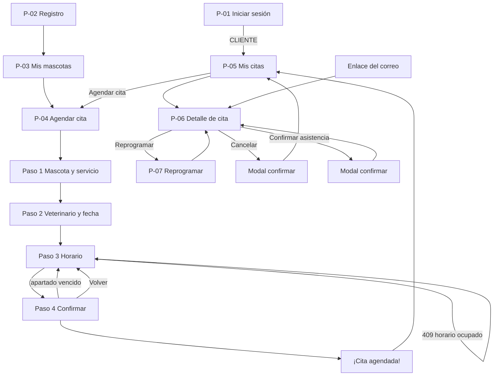
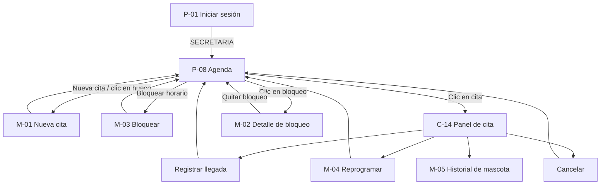

# ui-ux-spec — Sistema Web de Citas para Veterinaria

> Depende de `architecture-spec.md`, `feature-core-01.md` y `feature-core-02.md`. Esta spec define **qué ve y qué puede hacer cada rol**; las reglas de negocio, los endpoints y los errores están en los otros archivos y **no se reinterpretan aquí**. La UI nunca calcula plazos ni disponibilidad: usa `acciones_permitidas`, `segundos_restantes` y las respuestas de la API (RG-01).
>
> **Para el prototipo:** usar los datos semilla de `architecture-spec.md` §3.5, aplicar los mismos mensajes (§8) y simular las reglas (apartado de 5 min, choque de horario, plazos, estados de `Cita`).

## 1. Alcance y trazabilidad

| Pantalla | Rol | Requerimientos PRD | Spec funcional |
|---|---|---|---|
| P-01 Iniciar sesión | todos | RF-01, RNF-04 | architecture §3.6 |
| P-02 Registro | cliente | RF-01 | architecture §3.6 |
| P-03 Mis mascotas | cliente | RF-01 | architecture §3.6 |
| P-04 Agendar cita | cliente | RF-02, RF-03, RF-05, RNF-03 | core-01 §4–5 |
| P-05 Mis citas | cliente | RF-06, RF-11 | core-02 §5.1 |
| P-06 Detalle de cita | cliente | RF-06, RF-07 | core-02 §4 |
| P-07 Reprogramar cita | cliente | RF-06 | core-02 §4.C |
| P-08 Agenda de recepción (+ M-01…M-05) | secretaria | RF-04, RF-05, RF-06, RF-09, RF-10, RF-11 | core-01 §6–7, core-02 |
| P-09 Mi agenda | veterinario | RF-10 | core-01 §7, core-02 §4.F |
| P-10 Configuración | administrador | RF-08 | architecture §3.6 |
| P-11 Reportes | administrador | RF-12 | architecture §3.6 |

## 2. Roles, rutas y navegación

| Ruta | Pantalla | Rol permitido | Inicio por defecto de |
|---|---|---|---|
| `/login` | P-01 | público | — |
| `/registro` | P-02 | público | — |
| `/mascotas` | P-03 | CLIENTE | — |
| `/agendar` | P-04 | CLIENTE | — |
| `/citas` | P-05 | CLIENTE | CLIENTE |
| `/citas/:id` (admite `?accion=confirmar\|reprogramar\|cancelar`) | P-06 | CLIENTE | — |
| `/citas/:id/reprogramar` | P-07 | CLIENTE | — |
| `/agenda` | P-08 | SECRETARIA | SECRETARIA |
| `/mi-agenda` | P-09 | VETERINARIO | VETERINARIO |
| `/admin/configuracion` | P-10 | ADMINISTRADOR | ADMINISTRADOR |
| `/admin/reportes` | P-11 | ADMINISTRADOR | — |

Reglas de navegación:
- `/` redirige a la ruta de inicio del rol, o a `/login` si no hay sesión.
- Sin sesión en una ruta protegida → `/login?redirigir={ruta}`; tras iniciar sesión se vuelve a `{ruta}`.
- Rol sin permiso para la ruta → redirige a su inicio y muestra toast MSG-09.
- Respuesta 401 en cualquier llamada → toast MSG-26 y `/login?redirigir={ruta actual}`.

Menú (componente C-01) por rol:

| Rol | Opciones |
|---|---|
| CLIENTE | Agendar cita · Mis citas · Mis mascotas · Cerrar sesión |
| SECRETARIA | Agenda · Cerrar sesión |
| VETERINARIO | Mi agenda · Cerrar sesión |
| ADMINISTRADOR | Configuración · Reportes · Cerrar sesión |

## 3. Flujos de pantalla

**Cliente**

**Secretaria**

**Veterinario:** `P-01 → P-09` (ver citas del día → "Marcar atendida").
**Administrador:** `P-01 → P-10` (4 pestañas) y `P-11`.

## 4. Componentes

### 4.1 Catálogo

| ID | Componente | Props / contenido | Comportamiento |
|---|---|---|---|
| C-01 | `BarraNavegacion` | opciones por rol, nombre del usuario | Escritorio: barra superior. Móvil: menú hamburguesa. |
| C-02 | `CampoFormulario` | etiqueta, tipo, valor, error, ayuda | Error inline bajo el campo en rojo. Valida al salir del campo y al enviar. |
| C-03 | `Boton` | variante `primario`/`secundario`/`peligro`, `cargando`, `deshabilitado` | `cargando` muestra indicador y bloquea clics repetidos. |
| C-04 | `TarjetaMascota` | nombre, especie, raza, edad, `citas_activas` | Seleccionable (paso 1) o con "Editar" (P-03). Deshabilitada si `citas_activas = 2`, con texto "2 citas activas". |
| C-05 | `SelectorServicio` | lista de servicios activos con nombre y duración ("30 min") | Selección única. |
| C-06 | `SelectorVeterinario` | opción "Cualquiera disponible" (por defecto) + veterinarios activos | Selección única. |
| C-07 | `CalendarioFechas` | mes visible, días con disponibilidad (`/disponibilidad/dias`) | Días sin disponibilidad y pasados deshabilitados; "hoy" resaltado; navegación de mes. |
| C-08 | `GrillaHorarios` | `slots`, seleccionado | Chips de hora (`h:mm a. m.`) agrupados "Mañana" (antes de 12:00) y "Tarde"; selección única; esqueleto de 8 chips al cargar. |
| C-09 | `TemporizadorApartado` | `segundos_restantes` del servidor | Cuenta regresiva `m:ss`. Con < 60 s cambia a color de advertencia. En 0 abre modal MSG-02 y deshabilita "Confirmar cita". |
| C-10 | `ResumenCita` | mascota, servicio, veterinario, fecha, hora, duración, motivo | Solo lectura. |
| C-11 | `InsigniaEstado` | `estado`, `llegada_en` | Etiqueta con color (§4.2). Si `llegada_en ≠ null` y el estado es `AGENDADA`/`CONFIRMADA`, agrega la insignia "En sala". |
| C-12 | `TarjetaCita` | fecha y hora, servicio, mascota, veterinario, C-11 | Clic abre P-06. Texto largo con elipsis. |
| C-13 | `AgendaCuadricula` | columnas por veterinario (día) o por día (semana), eje de horas | 1 fila = 15 min. Bloques de cita (color por estado), bloques de bloqueo (gris rayado), fuera de turno (gris claro, no clicable), banner en columna con `FERIADO`/`DIA_LIBRE`, línea de "ahora" en el día actual. Clic en hueco libre dentro del turno y con `inicio ≥ ahora` abre M-01 prellenado. |
| C-14 | `PanelDetalleCita` | `CitaDetalle` completo (incluye cliente) | Escritorio: panel lateral. Móvil: hoja a pantalla completa. Botones según `acciones_permitidas`: "Registrar llegada", "Reprogramar", "Cancelar cita", más enlace "Ver historial de la mascota" (abre M-05). |
| C-15 | `ModalConfirmacion` | título, texto, botón principal, botón secundario | Botón principal con estado `cargando`. Se cierra con "Esc" y con el secundario. |
| C-16 | `Toast` | tipo `exito`/`error`, texto | Se oculta a los 5 s; apilable. |
| C-17 | `EstadoVacio` | ícono, texto, acción opcional | Ver textos por pantalla. |
| C-18 | `Esqueleto` | forma (tarjeta, chip, columna) | Reemplaza el contenido mientras carga. |
| C-19 | `BannerError` | texto, botón "Reintentar" | Bloque inline no modal. |
| C-20 | `Pestanas` | etiquetas, activa | Cambia de vista sin recargar la página. |
| C-21 | `BuscadorCliente` | texto (≥ 2 caracteres) | Busca con retardo de 300 ms (`GET /api/clientes?q=`); lista máx. 10 con nombre, teléfono y correo; opción "Registrar nuevo cliente". Sin resultados: "No encontramos clientes" (MSG-44). |
| C-22 | `TablaDatos` | columnas, filas | Desplazamiento horizontal **dentro** del contenedor en móvil. |
| C-23 | `TarjetaIndicador` | título, valor | Usada en reportes. |
| C-24 | `IndicadorTiempoReal` | tiempo desde la última actualización | "Actualizado hace N s"; punto verde si SSE conectado, ámbar si está en *polling*. |

### 4.2 Convenciones visuales

| Estado de cita | Etiqueta | Color base |
|---|---|---|
| `APARTADA` | Apartada | gris (`gray-500`) |
| `AGENDADA` | Agendada | azul (`blue-600`) |
| `CONFIRMADA` | Confirmada | verde (`green-600`) |
| `ATENDIDA` | Atendida | verde azulado (`teal-700`) |
| `CANCELADA` | Cancelada | rojo (`red-500`) |
| `REPROGRAMADA` | Reprogramada | violeta (`purple-500`) |
| `INASISTENCIA` | Inasistencia | naranja (`orange-500`) |
| *(adicional)* | En sala | cian (`cyan-600`) |

- **Responsive (RNF-03):** *mobile-first*. Móvil < 640 px; tablet 640–1023 px; escritorio ≥ 1024 px. Nunca hay desplazamiento horizontal de la página; solo dentro de C-13 y C-22.
- **Táctil:** objetivos interactivos ≥ 44 × 44 px.
- **Texto:** español; fechas `DD/MM/YYYY`; horas 12 h; la UI siempre muestra la hora de `America/Costa_Rica`.
- **Nunca se comunica un estado solo con color:** la insignia siempre lleva su etiqueta.

## 5. Pantallas

### P-01 Iniciar sesión — `/login`

- **Elementos:** campos `correo`, `contrasena` (con mostrar/ocultar); botón "Iniciar sesión"; enlace "Crear cuenta" → `/registro`.
- **Validación:** correo con formato válido; contraseña no vacía.
- **Acción:** `POST /api/auth/login` → redirige según §2.

| Vacío | Cargando | Éxito | Error |
|---|---|---|---|
| (formulario vacío es el estado inicial) | Botón con indicador y deshabilitado | Redirige al inicio del rol o a `redirigir` | `CREDENCIALES_INVALIDAS` → banner MSG-07; otro → MSG-10 |

### P-02 Registro — `/registro`

| Campo | Tipo | Validación |
|---|---|---|
| `nombre_completo` | texto | 2–100 caracteres |
| `correo` | email | formato válido, ≤ 254 |
| `telefono` | texto con máscara `XXXX-XXXX` | 8 dígitos |
| `contrasena` | contraseña | 8–64 caracteres, ≥ 1 letra y ≥ 1 número (RG-15) |
| `confirmar_contrasena` | contraseña | igual a `contrasena` |
| `acepta_datos` | casilla "Acepto el tratamiento de mis datos personales conforme a la Ley 8968" | obligatoria (RG-16) |

Acción: botón "Crear cuenta" → `POST /api/auth/registro` → redirige a `/mascotas`.

| Vacío | Cargando | Éxito | Error |
|---|---|---|---|
| Formulario inicial | Botón con indicador | Sesión iniciada → `/mascotas` | Errores inline por campo; `CORREO_DUPLICADO` → MSG-08 bajo el campo correo; otro → MSG-10 |

### P-03 Mis mascotas — `/mascotas`

- **Elementos:** lista de C-04 (nombre, especie, raza, edad, "N citas activas"); botón "Agregar mascota"; en cada tarjeta, "Editar".
- **Formulario (modal):** `nombre` (1–50), `especie` (lista: Perro, Gato, Ave, Roedor, Otro), `raza` (0–50, opcional), `edad_anios` (0–40; ayuda "0 = menos de 1 año"). Botón "Guardar".
- **API:** `GET/POST /api/mascotas`, `PUT /api/mascotas/{id}`.

| Vacío | Cargando | Éxito | Error |
|---|---|---|---|
| "Aún no tienes mascotas registradas" (MSG-32) + botón "Registrar mascota" | 2 tarjetas-esqueleto | Lista actualizada + toast MSG-28 | Banner con "Reintentar"; errores de formulario inline |

### P-04 Agendar cita — `/agendar` (asistente de 4 pasos)

Barra de progreso "Paso N de 4". Botón "Atrás" en los pasos 2–4. El asistente **no** guarda progreso al recargar (EC-UI-02).

| Paso | Contenido | Condición para continuar | Acción de API |
|---|---|---|---|
| 1. Mascota y servicio | Lista C-04 y C-05 | Mascota (con `citas_activas < 2`) y servicio seleccionados | `GET /api/mascotas`, `GET /api/servicios` |
| 2. Veterinario y fecha | C-06 y C-07 | Fecha seleccionada | `GET /api/veterinarios`, `GET /api/disponibilidad/dias` |
| 3. Horario | C-08 para la fecha elegida | Horario seleccionado | `GET /api/disponibilidad`; al pulsar "Continuar": `POST /api/citas/apartados` |
| 4. Confirmar | C-10 (con veterinario asignado), campo `motivo` (0–500, opcional, contador de caracteres), C-09 | Temporizador > 0 | "Confirmar cita": `POST /api/citas/{id}/confirmar-apartado`. "Atrás": `DELETE /api/citas/{id}/apartado` y vuelve al paso 3 |

Comportamiento:
- Cambiar de fecha o veterinario en el paso 2/3 limpia el horario elegido.
- Tras `HORARIO_NO_DISPONIBLE` el paso 3 recarga la grilla de la misma fecha, muestra MSG-01 y deja el horario sin seleccionar.
- Éxito: pantalla "¡Cita agendada!" con MSG-11, resumen C-10 y botones "Ver mis citas" y "Agendar otra".

**Estados** (textos exactos; detalle de errores en `feature-core-01.md` §9):

| Paso | Vacío | Cargando | Éxito | Error |
|---|---|---|---|---|
| 1 | "Aún no tienes mascotas registradas" (MSG-32) + "Registrar mascota" (→ P-03) | 2 tarjetas-esqueleto | Tarjetas seleccionables | MSG-10 + "Reintentar" |
| 2 | "No hay fechas disponibles este mes" (MSG-33) (todos los días deshabilitados) | Calendario en esqueleto | Días con disponibilidad habilitados | MSG-10 + "Reintentar" |
| 3 | "No hay horarios disponibles para este día" (MSG-34) + "Probar con otra fecha" (y "Ver todos los veterinarios" si había uno elegido) | 8 chips-esqueleto | Chips Mañana / Tarde | MSG-10 + "Reintentar"; `HORARIO_NO_DISPONIBLE` → MSG-01; `ANTICIPACION_INSUFICIENTE` → MSG-05; `LIMITE_CITAS_MASCOTA` → MSG-04; `FUERA_DE_HORARIO` → MSG-06; `VENTANA_EXCEDIDA` → MSG-20 |
| 4 | — | "Confirmar cita" con indicador | Pantalla "¡Cita agendada!" | `APARTADO_EXPIRADO` → modal MSG-02 con botón "Elegir otro horario" (vuelve al paso 3); otro → MSG-10 |

### P-05 Mis citas — `/citas`

- **Elementos:** C-20 con pestañas "Próximas" (por defecto) e "Historial"; filtro "Todas mis mascotas" / una mascota (`mascota_id`); lista de C-12; botón "Agendar cita"; en Historial, botón "Cargar más" (paginación de 20).
- **API:** `GET /api/citas/mias?vista=…`.

| Vacío | Cargando | Éxito | Error |
|---|---|---|---|
| Próximas: "No tienes citas próximas" (MSG-35) + "Agendar cita". Historial: "Aún no hay citas en tu historial" (MSG-36) | 3 tarjetas-esqueleto | Lista de C-12 | MSG-10 + "Reintentar" |

### P-06 Detalle de cita — `/citas/:id`

- **Elementos:** C-11, datos de la cita (fecha y hora, duración, servicio, veterinario, mascota, motivo, `cita_origen_id` → texto "Reprogramada desde la cita del {fecha}" si existe); botones según `acciones_permitidas`: "Confirmar asistencia" (primario), "Reprogramar" (secundario), "Cancelar cita" (peligro).
- Si el estado es `AGENDADA`/`CONFIRMADA`, `llegada_en` es null y `cancelar` y `reprogramar` son `false`: se muestra el aviso MSG-03 y los botones quedan deshabilitados.
- Con `?accion=` en la URL: `confirmar` abre el modal de confirmar; `cancelar` abre el modal de cancelar; `reprogramar` navega a P-07; si la acción no está permitida se muestra MSG-16 (o MSG-03 por plazo) sin abrir el modal.
- **Modales (C-15):**
  - Confirmar: título "Confirmar asistencia", texto "Confirmas que {mascota} asistirá el {fecha} a las {hora}.", botones "Confirmar" / "Cerrar".
  - Cancelar: título "¿Cancelar esta cita?", texto "Se liberará el horario del {fecha} a las {hora}.", botones "Sí, cancelar" / "No, mantener".

| Vacío | Cargando | Éxito | Error |
|---|---|---|---|
| — | Esqueleto del detalle | Confirmar → toast MSG-14. Cancelar → toast MSG-12 y vuelve a P-05 | Cita inexistente: "No encontramos esta cita" (MSG-29) + "Volver a mis citas". `PLAZO_VENCIDO` → MSG-03. `TRANSICION_INVALIDA` → MSG-16 + refresco. Otro → MSG-10 |

### P-07 Reprogramar cita — `/citas/:id/reprogramar`

- Tarjeta superior "Cita actual" (C-10 de la original: mascota y servicio fijos).
- Asistente de 3 pasos: 1 Veterinario y fecha (C-06, C-07) → 2 Horario (C-08; al continuar crea el apartado con `cita_origen_id`) → 3 Confirmar (comparación "Cita actual → Nueva cita" con C-09). Botón "Confirmar reprogramación".
- Estados: iguales a P-04 pasos 2, 3 y 4. Éxito: toast MSG-13 y regreso a P-06. `APARTADO_EXPIRADO` → modal MSG-02 (vuelve al paso 2). `PLAZO_VENCIDO` → MSG-03 y regreso a P-06.

### P-08 Agenda de recepción — `/agenda`

- **Barra superior:** navegación de fecha ("‹", "Hoy", "›", selector de fecha); alternador "Día" / "Semana"; filtro de veterinarios (en "Día": selección múltiple, por defecto todos; en "Semana": selección única, por defecto el primero); botones "Nueva cita" (abre M-01) y "Bloquear horario" (abre M-03); C-24.
- **Cuerpo:** C-13. Clic en una cita abre C-14; clic en un bloqueo abre M-02.
- **Móvil:** vista "Día" en una sola columna con pestañas (C-20) para cambiar de veterinario; "Semana" con desplazamiento horizontal dentro de C-13.
- **Tiempo real:** al recibir `agenda.cambio` del rango visible, recarga `GET /api/agenda` y actualiza C-24.

| Vacío | Cargando | Éxito | Error |
|---|---|---|---|
| "No hay citas para este día" (MSG-37) sobre la cuadrícula con los turnos visibles | Esqueleto de columnas | Cuadrícula con citas y bloqueos + "Actualizado hace N s" | "No se pudo actualizar la agenda. Reintentando…" (MSG-31) + "Reintentar"; conserva la última vista |

**M-01 Nueva cita** (modal; formulario en una sola columna con secciones):
1. **Cliente:** C-21; si no existe, "Registrar nuevo cliente" muestra `nombre_completo` (2–100), `telefono` (8 dígitos), `correo` (opcional).
2. **Mascota:** lista de mascotas del cliente o "Registrar nueva mascota" (mismos campos que P-03).
3. **Servicio, veterinario (obligatorio, RG-08), fecha y horario:** C-05, selector de veterinario sin "Cualquiera", fecha, C-08 (horarios desde ahora).
4. **Canal** (radio: "Teléfono" por defecto / "Presencial") y `motivo` (0–500).
Botón "Agendar cita". Éxito: se cierra, toast MSG-23. Errores: `HORARIO_NO_DISPONIBLE` → MSG-01; `FUERA_DE_HORARIO` → MSG-06; `LIMITE_CITAS_MASCOTA` → MSG-04; el modal no se cierra. Si un evento SSE quita el horario elegido, se deselecciona y se muestra MSG-01.

**M-02 Detalle de bloqueo** (panel; misma forma que C-14): veterinario, fecha, hora de inicio y de fin, motivo y quién lo creó. Botón "Quitar bloqueo" (peligro) → `DELETE /api/bloqueos/{id}`. Éxito: se cierra, toast MSG-25 y el horario vuelve a quedar disponible. Si otra secretaria ya lo quitó, se cierra y la agenda se refresca; otro error → MSG-10.

**M-03 Bloquear horario:** campos `veterinario`, `fecha`, `hora de inicio`, `hora de fin` (listas cada 15 min), `motivo` (0–100, opcional). Botón "Bloquear". Éxito: toast MSG-24. Errores: `BLOQUEO_CON_CITAS` → MSG-15 (con lista de citas en conflicto: hora y mascota); `BLOQUEO_SOLAPADO` → MSG-21; `VALIDACION` inline.

**M-04 Reprogramar (recepción):** campos `veterinario`, `fecha`, C-08 (horarios desde ahora). Botón "Reprogramar". Éxito: toast MSG-13. Errores como M-01.

**M-05 Historial de la mascota:** lista paginada (`GET /api/mascotas/{id}/historial`) con fecha y hora, servicio, veterinario, C-11 y motivo. Vacío: "Esta mascota aún no tiene citas" (MSG-39). Cargando: 3 filas-esqueleto. Error: MSG-10 + "Reintentar".

**C-14 (panel de cita):** muestra C-11, cliente (nombre, teléfono, correo), mascota (nombre, especie, raza, edad), servicio, veterinario, canal, motivo y botones por `acciones_permitidas`. Cancelar usa el modal de P-06 con el mismo texto. Éxitos: "Registrar llegada" → toast MSG-18; "Cancelar cita" → toast MSG-12.

### P-09 Mi agenda — `/mi-agenda`

- **Elementos:** navegación de fecha (solo día); lista cronológica de citas del veterinario conectado: hora y duración, servicio, mascota (nombre, especie, raza, edad), motivo, C-11 (con "En sala" si aplica); botón "Marcar atendida" habilitado según `acciones_permitidas.marcar_atendida`. **No se muestran datos del cliente** (RG-17).
- Tiempo real: `agenda.cambio` del veterinario recarga la lista.

| Vacío | Cargando | Éxito | Error |
|---|---|---|---|
| "No tienes citas para este día" (MSG-38) | 3 tarjetas-esqueleto | Lista de citas; al marcar atendida: toast MSG-19 e insignia "Atendida" | MSG-10 + "Reintentar"; `TRANSICION_INVALIDA` → MSG-16 + refresco |

### P-10 Configuración — `/admin/configuracion`

C-20 con 4 pestañas. Cada pestaña tiene botón "Guardar cambios" (éxito: toast MSG-22).

| Pestaña | Contenido | Validación |
|---|---|---|
| Servicios | Tabla (nombre, duración, activo) y formulario "Nuevo servicio" | `nombre` 2–60 y único; `duracion_min` lista 15, 30, …, 480 (cada 15) |
| Horario de atención | 7 filas (lunes a domingo): interruptor "Abierto", hora de apertura y de cierre | Horas cada 15 min; cierre > apertura; día cerrado = sin horas |
| Veterinarios y turnos | Lista de veterinarios (interruptor activo); formulario "Nuevo veterinario" (`nombre_completo`, `correo`, `contrasena`); por veterinario, editor de turnos por día (uno o más rangos) | Rangos cada 15 min, `fin > inicio`, sin solapamiento en el mismo día; correo único (`CORREO_DUPLICADO` → MSG-08) |
| Días libres y feriados | Lista de próximos días y formulario: `tipo` (Feriado / Día libre), `fecha` (≥ hoy), `veterinario` (solo para Día libre), `motivo` (0–100) | Duplicados rechazados |

Errores comunes: `CONFIGURACION_CON_CITAS` → MSG-17 con lista de citas afectadas (fecha, hora, mascota); no se guarda el cambio. `SIN_PERMISO` → MSG-09.

| Vacío | Cargando | Éxito | Error |
|---|---|---|---|
| Servicios: "Aún no hay servicios" (MSG-40) + "Nuevo servicio". Veterinarios: "Aún no hay veterinarios" (MSG-41) + "Nuevo veterinario". Días libres: "No hay días libres ni feriados próximos" (MSG-42) | Esqueleto de tabla | Datos guardados + toast MSG-22 | MSG-10 + "Reintentar"; errores de validación inline |

### P-11 Reportes — `/admin/reportes`

- **Filtros:** `desde` y `hasta` (por defecto, el mes actual), `agrupar por` (Día, Servicio, Veterinario, Canal; por defecto Día). Botón "Aplicar". Validación: `desde ≤ hasta`.
- **Contenido:** 5 tarjetas C-23 ("Total de citas", "Atendidas", "Inasistencias", "Tasa de inasistencia", "Citas en línea") y tabla C-22 con columnas Etiqueta, Total, Atendidas, Inasistencias, Canceladas.
- Tasa o porcentaje sin datos se muestra como "—".

| Vacío | Cargando | Éxito | Error |
|---|---|---|---|
| "No hay citas en el rango seleccionado" (MSG-43) | Tarjetas y filas en esqueleto | Tarjetas y tabla con datos | MSG-10 + "Reintentar" |

## 6. Casos borde de interfaz

| ID | Caso | Comportamiento esperado |
|---|---|---|
| EC-UI-01 | La sesión expira durante cualquier pantalla (401) | Toast MSG-26 y redirección a `/login?redirigir={ruta}` |
| EC-UI-02 | Se recarga la página en el paso 3 o 4 de P-04 | El asistente vuelve al paso 1; el apartado previo vence solo o se reemplaza (RG-11) |
| EC-UI-03 | El temporizador llega a 0 | Modal MSG-02 y "Confirmar cita" deshabilitado; no se llama a la API |
| EC-UI-04 | Se pierde la conexión | Banner no modal "Sin conexión. Reintentando…" (MSG-30); las acciones se deshabilitan hasta recuperarla |
| EC-UI-05 | Doble clic en un botón de acción | El botón pasa a `cargando` en el primer clic y ignora los siguientes |
| EC-UI-06 | Motivo o nombre muy largo | Elipsis en tarjetas y agenda; texto completo en detalle y paneles |
| EC-UI-07 | Un evento SSE llega con el modal M-01 abierto | La grilla de horarios se refresca; el horario elegido, si desapareció, se deselecciona con MSG-01 |
| EC-UI-08 | Cliente sin correo agenda por recepción | La confirmación de la secretaria es MSG-23 (sin mención de correo) |
| EC-UI-09 | Enlace de correo con `?accion=` sobre cita en estado terminal | Detalle sin botones y aviso MSG-16 |
| EC-UI-10 | Móvil de 360 px de ancho | Sin desplazamiento horizontal de la página; botones principales ocupan el ancho completo |
| EC-UI-11 | Cliente con una sola mascota | El paso 1 la preselecciona; sigue requiriendo elegir servicio |

## 7. Textos de botones y etiquetas que no deben variar

"Iniciar sesión", "Crear cuenta", "Agregar mascota", "Registrar mascota", "Guardar", "Continuar", "Atrás", "Confirmar cita", "Elegir otro horario", "Confirmar asistencia", "Reprogramar", "Cancelar cita", "Registrar llegada", "Marcar atendida", "Nueva cita", "Bloquear horario", "Quitar bloqueo", "Guardar cambios", "Reintentar", "Cerrar sesión".

## 8. Catálogo de mensajes

| ID | Origen | Texto |
|---|---|---|
| MSG-01 | `HORARIO_NO_DISPONIBLE` | **Ese horario acaba de ser reservado** — "Te mostramos otros horarios disponibles." |
| MSG-02 | `APARTADO_EXPIRADO` | Tu reserva temporal venció. Elige un horario de nuevo. |
| MSG-03 | `PLAZO_VENCIDO` | Faltan menos de 4 horas para tu cita. Llama a recepción para cancelar o reprogramar. |
| MSG-04 | `LIMITE_CITAS_MASCOTA` | {mascota} ya tiene 2 citas activas. Cancela una o espera a que se atienda para agendar otra. |
| MSG-05 | `ANTICIPACION_INSUFICIENTE` | Las citas en línea requieren al menos 2 horas de anticipación. |
| MSG-06 | `FUERA_DE_HORARIO` | Ese horario no está dentro del horario de atención. |
| MSG-07 | `CREDENCIALES_INVALIDAS` | Correo o contraseña incorrectos. |
| MSG-08 | `CORREO_DUPLICADO` | Ya existe una cuenta con este correo. |
| MSG-09 | `SIN_PERMISO` | No tienes permiso para realizar esta acción. |
| MSG-10 | error genérico o de red | Algo salió mal. Intenta de nuevo. |
| MSG-11 | éxito al agendar en línea | ¡Cita agendada! Te enviamos la confirmación a {correo}. |
| MSG-12 | éxito al cancelar | La cita fue cancelada. |
| MSG-13 | éxito al reprogramar | La cita fue reprogramada para el {DD/MM/YYYY} a las {hora}. |
| MSG-14 | éxito al confirmar asistencia | Cita confirmada. ¡Te esperamos! |
| MSG-15 | `BLOQUEO_CON_CITAS` | Hay citas en ese horario. Cancélalas o reprográmalas primero. |
| MSG-16 | `TRANSICION_INVALIDA` | Esta cita cambió de estado. Actualizamos la información. |
| MSG-17 | `CONFIGURACION_CON_CITAS` | Hay citas activas afectadas. Reprográmalas o cancélalas primero. |
| MSG-18 | éxito al registrar llegada | Llegada registrada. |
| MSG-19 | éxito al marcar atendida | Cita marcada como atendida. |
| MSG-20 | `VENTANA_EXCEDIDA` | Solo puedes agendar con hasta 60 días de anticipación. |
| MSG-21 | `BLOQUEO_SOLAPADO` | Ya existe un bloqueo en ese horario. |
| MSG-22 | éxito al guardar configuración | Cambios guardados. |
| MSG-23 | éxito de la secretaria al agendar | Cita agendada. |
| MSG-24 | éxito al bloquear | Horario bloqueado. |
| MSG-25 | éxito al quitar bloqueo | Bloqueo eliminado. |
| MSG-26 | `NO_AUTENTICADO` | Tu sesión expiró. Inicia sesión de nuevo. |
| MSG-27 | `VALIDACION` al registrar llegada otro día | La llegada solo se registra el día de la cita. |
| MSG-28 | éxito al guardar mascota | Mascota guardada. |
| MSG-29 | cita inexistente (P-06) | No encontramos esta cita. |
| MSG-30 | sin conexión (EC-UI-04) | Sin conexión. Reintentando… |
| MSG-31 | fallo al recargar la agenda (P-08) | No se pudo actualizar la agenda. Reintentando… |
| MSG-32 | vacío: cliente sin mascotas (P-03, P-04 paso 1) | Aún no tienes mascotas registradas |
| MSG-33 | vacío: mes sin disponibilidad (P-04 paso 2) | No hay fechas disponibles este mes |
| MSG-34 | vacío: día sin horarios (P-04 paso 3, P-07) | No hay horarios disponibles para este día |
| MSG-35 | vacío: P-05 Próximas | No tienes citas próximas |
| MSG-36 | vacío: P-05 Historial | Aún no hay citas en tu historial |
| MSG-37 | vacío: P-08 Agenda | No hay citas para este día |
| MSG-38 | vacío: P-09 Mi agenda | No tienes citas para este día |
| MSG-39 | vacío: M-05 Historial de la mascota | Esta mascota aún no tiene citas |
| MSG-40 | vacío: P-10 Servicios | Aún no hay servicios |
| MSG-41 | vacío: P-10 Veterinarios | Aún no hay veterinarios |
| MSG-42 | vacío: P-10 Días libres | No hay días libres ni feriados próximos |
| MSG-43 | vacío: P-11 Reportes | No hay citas en el rango seleccionado |
| MSG-44 | vacío: búsqueda de clientes (C-21, M-01) | No encontramos clientes |

Notas: en MSG-11, si el cliente no tiene correo el texto es solo "¡Cita agendada!". Los errores `VALIDACION` de formulario se muestran inline bajo cada campo con el mensaje del servidor en `detalles.campos`.

## 9. Criterios de aceptación

**AC-UI-01 — Máximo 4 pasos (RNF-03)**
**Given** un cliente con una mascota **When** agenda una cita en línea **Then** completa el proceso en los 4 pasos de P-04 y "Confirmar cita" está en el paso 4.

**AC-UI-02 — Apartado visible**
**Given** el cliente elige un horario y pulsa "Continuar" **When** llega al paso 4 **Then** ve el temporizador C-09 iniciado en 5:00 (según `segundos_restantes`) y el veterinario asignado en el resumen.

**AC-UI-03 — Temporizador agotado**
**Given** el cliente está en el paso 4 **When** el temporizador llega a 0:00 **Then** se abre el modal con MSG-02, "Confirmar cita" queda deshabilitado y "Elegir otro horario" lo regresa al paso 3 con la grilla recargada.

**AC-UI-04 — Horario ocupado (RF-03)**
**Given** el cliente pulsa "Continuar" en un horario que otro cliente apartó antes **When** la API responde `HORARIO_NO_DISPONIBLE` **Then** se muestra "Ese horario acaba de ser reservado", se recarga la grilla y no se avanza al paso 4.

**AC-UI-05 — Estados del paso 3**
**Given** el cliente está en el paso 3 **When** la consulta tarda **Then** se ven 8 chips-esqueleto; **when** responde sin horarios **then** se ve "No hay horarios disponibles para este día" con "Probar con otra fecha"; **when** falla **then** se ve MSG-10 con "Reintentar".

**AC-UI-06 — Mascota en el límite (RN-07)**
**Given** Luna tiene `citas_activas = 2` **When** el cliente está en el paso 1 **Then** su tarjeta aparece deshabilitada con el texto "2 citas activas" y no puede seleccionarse.

**AC-UI-07 — Plazo vencido en el detalle (RN-06)**
**Given** una cita `AGENDADA` a menos de 4 h con `acciones_permitidas.cancelar = false` **When** el cliente abre P-06 **Then** "Cancelar cita" y "Reprogramar" están deshabilitados y se muestra MSG-03.

**AC-UI-08 — Cancelar con confirmación**
**Given** una cita con `acciones_permitidas.cancelar = true` **When** el cliente pulsa "Cancelar cita" y luego "Sí, cancelar" **Then** se muestra MSG-12 y vuelve a P-05 sin esa cita en "Próximas".

**AC-UI-09 — Enlace del recordatorio**
**Given** el cliente abre `/citas/{id}?accion=confirmar` sin sesión **When** inicia sesión **Then** vuelve a esa ruta y ve el modal "Confirmar asistencia".

**AC-UI-10 — Rutas por rol**
**Given** una sesión `SECRETARIA` **When** navega a `/admin/reportes` **Then** es redirigida a `/agenda` y ve MSG-09; y su menú solo muestra "Agenda" y "Cerrar sesión".

**AC-UI-11 — Agenda en tiempo real (RF-04, RNF-02)**
**Given** una secretaria con P-08 abierta **When** otra crea una cita para el mismo día **Then** el bloque aparece en ≤ 5 s sin recargar y C-24 se actualiza.

**AC-UI-12 — Nueva cita por recepción**
**Given** la secretaria abre M-01 y busca "Ana" **When** selecciona a Ana Rodríguez, la mascota Luna, servicio, veterinario, fecha, horario y canal Teléfono y pulsa "Agendar cita" **Then** el modal se cierra, aparece MSG-23 y el bloque se ve en la agenda.

**AC-UI-13 — Bloqueo con citas**
**Given** hay una cita en el rango **When** la secretaria intenta bloquear en M-03 **Then** el modal muestra MSG-15 con la cita en conflicto y no se cierra.

**AC-UI-14 — Llegada y atención**
**Given** una cita `AGENDADA` de hoy **When** la secretaria pulsa "Registrar llegada" **Then** se muestra MSG-18 y la insignia "En sala"; **and** en P-09 del veterinario el botón "Marcar atendida" pasa a habilitado.

**AC-UI-15 — Privacidad del veterinario (RG-17)**
**Given** una sesión `VETERINARIO` **When** ve P-09 **Then** cada cita muestra datos de la mascota y el motivo, y no muestra nombre, teléfono ni correo del cliente.

**AC-UI-21 — Quitar bloqueo (RF-09)**
**Given** un bloqueo del Dr. Vargas de 14:00 a 15:00 en P-08 **When** la secretaria lo abre (M-02) y pulsa "Quitar bloqueo" **Then** se muestra MSG-25, el bloque desaparece de la agenda y esas horas vuelven a ofrecerse en la web en ≤ 5 s.

**AC-UI-16 — Insignias de estado**
**Given** citas en los 7 estados **When** se listan **Then** cada una muestra su etiqueta y color de §4.2 y, si tiene `llegada_en` y está `AGENDADA` o `CONFIRMADA`, también "En sala".

**AC-UI-17 — Configuración con citas afectadas (RF-08)**
**Given** el admin crea un "Día libre" para la Dra. Solís en una fecha con citas activas **When** pulsa "Guardar cambios" **Then** se muestra MSG-17 con la lista de citas afectadas y el día libre no se crea.

**AC-UI-18 — Reportes vacíos**
**Given** el rango no contiene citas **When** el admin pulsa "Aplicar" **Then** se muestra "No hay citas en el rango seleccionado" y las tarjetas de tasa y porcentaje muestran "—".

**AC-UI-19 — Registro inválido (RF-01)**
**Given** el formulario de P-02 **When** el cliente envía una contraseña "abc" y no marca la casilla de datos **Then** se muestran errores inline en `contrasena` y `acepta_datos` y no se llama a la API.

**AC-UI-20 — Móvil (RNF-03)**
**Given** un viewport de 360 px **When** el cliente recorre P-04 **Then** no hay desplazamiento horizontal de la página y los botones principales miden al menos 44 px de alto.
