# Enlace del prototipo

- **Herramienta:** Google Stitch
- **Proyecto:** VetCitas Sistema de Citas
- **URL del prototipo (vista previa navegable):** https://stitch.google.com/preview/16056898836837622110?node-id=848ae421ad79498cbe0f74062796931e
- **URL del proyecto en Stitch (edición):** https://stitch.google.com/projects/16056898836837622110
- **Generado a partir de:** los 4 archivos de `03-specs/` (ver `prompts-utilizados.md`)
- **Vista:** móvil (mobile-first). Las cuentas demo se eligen desde la pantalla de Iniciar sesión.

## Capturas de respaldo

| # | Pantalla | Rol | Spec | Captura |
|---|---|---|---|---|
| 1 | Iniciar sesión (con error de credenciales y cuentas demo) | Todos | P-01 | 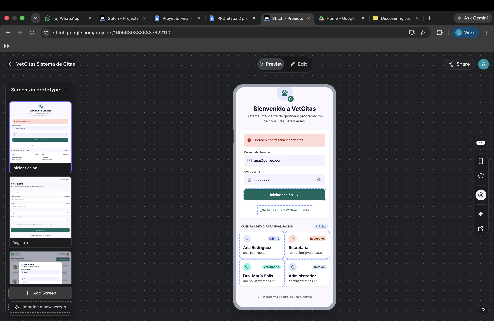 |
| 2 | Registro (casilla Ley 8968) | Cliente | P-02 | 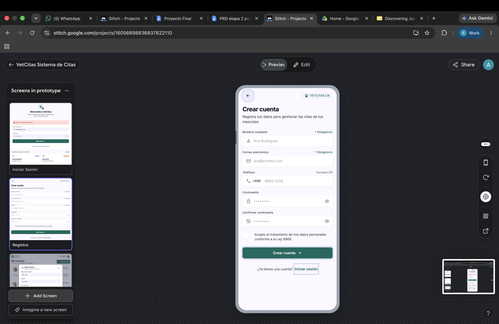 |
| 3 | Mis mascotas – Editar mascota | Cliente | P-03 | 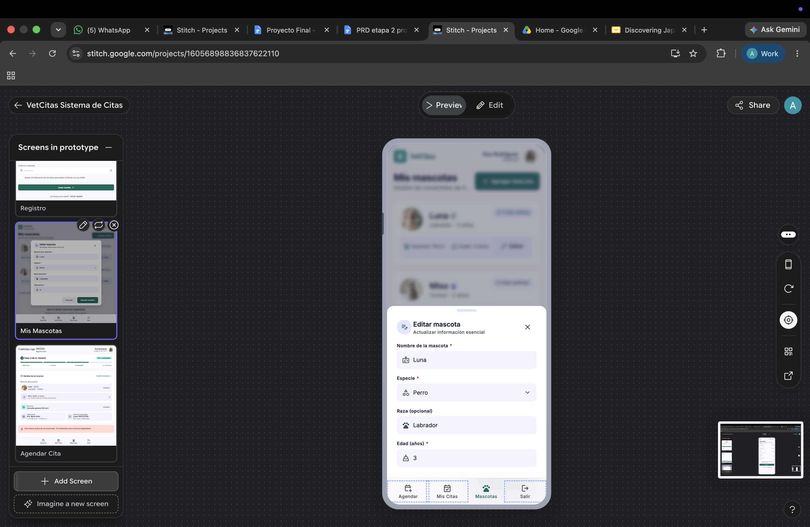 |
| 4 | Agendar – Paso 1 Mascota y servicio (Miso bloqueada por 2 citas activas) | Cliente | P-04, RN-07 | 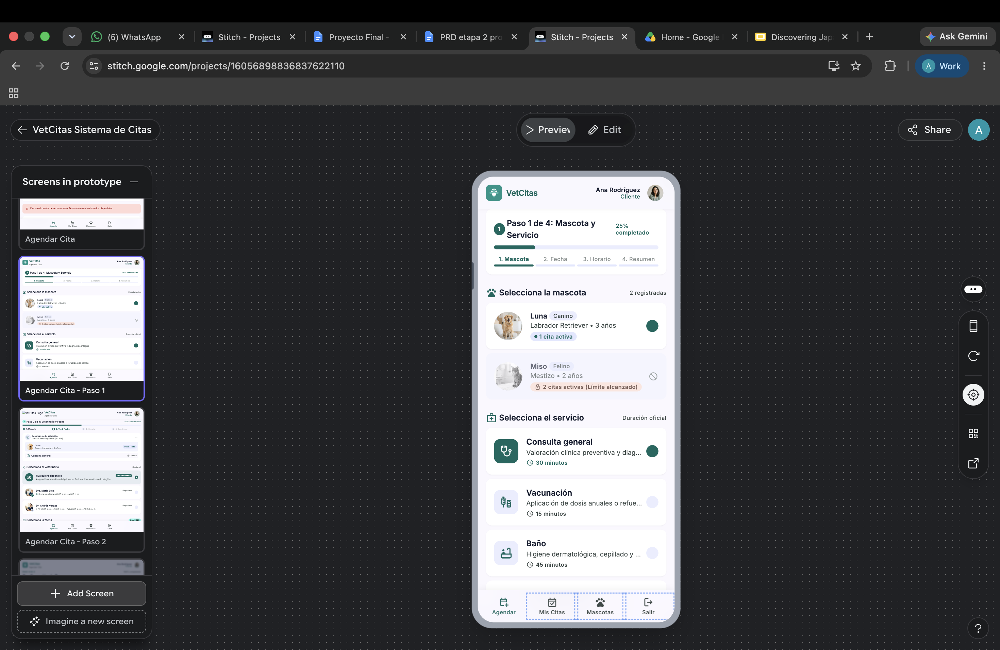 |
| 5 | Agendar – Paso 2 Veterinario y fecha | Cliente | P-04, RG-06 | 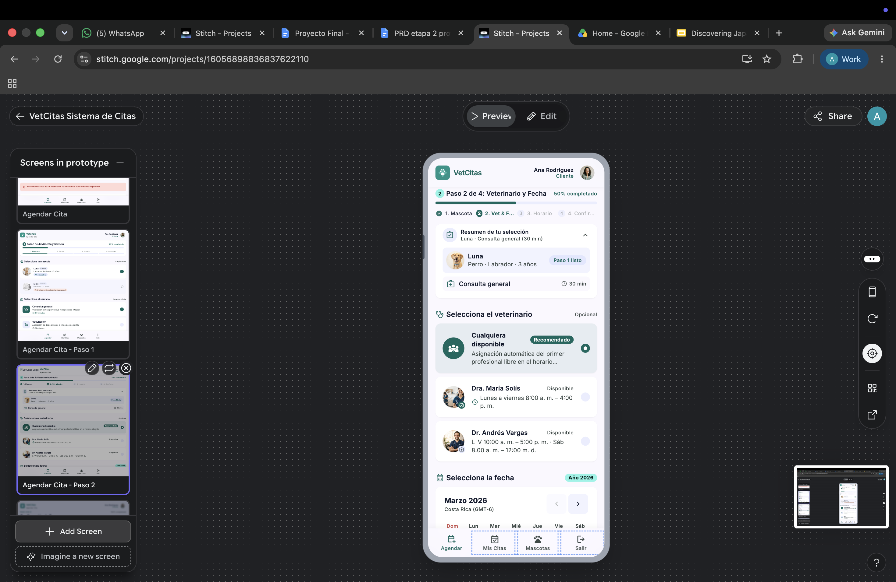 |
| 6 | Agendar – Paso 3 Horario ("Ese horario acaba de ser reservado") | Cliente | P-04, RF-03 | 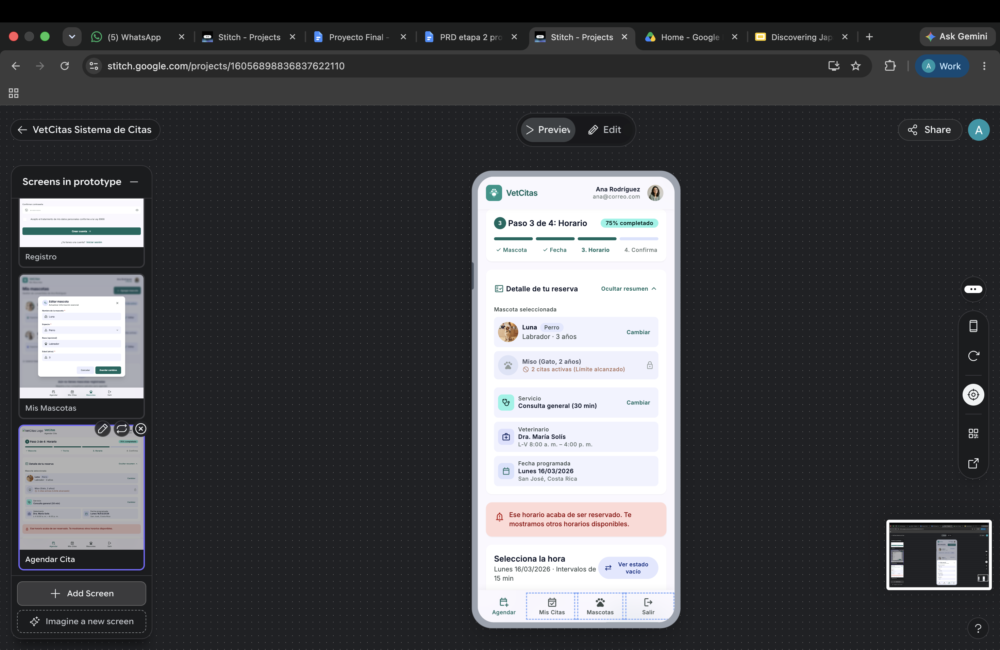 |
| 7 | Agendar – Paso 4 Tiempo agotado del apartado | Cliente | P-04, RN-04 | 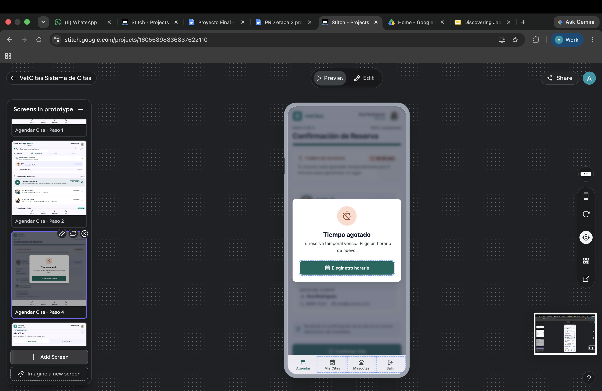 |
| 8 | Mis citas (aviso de menos de 4 horas) | Cliente | P-05, RN-06 | 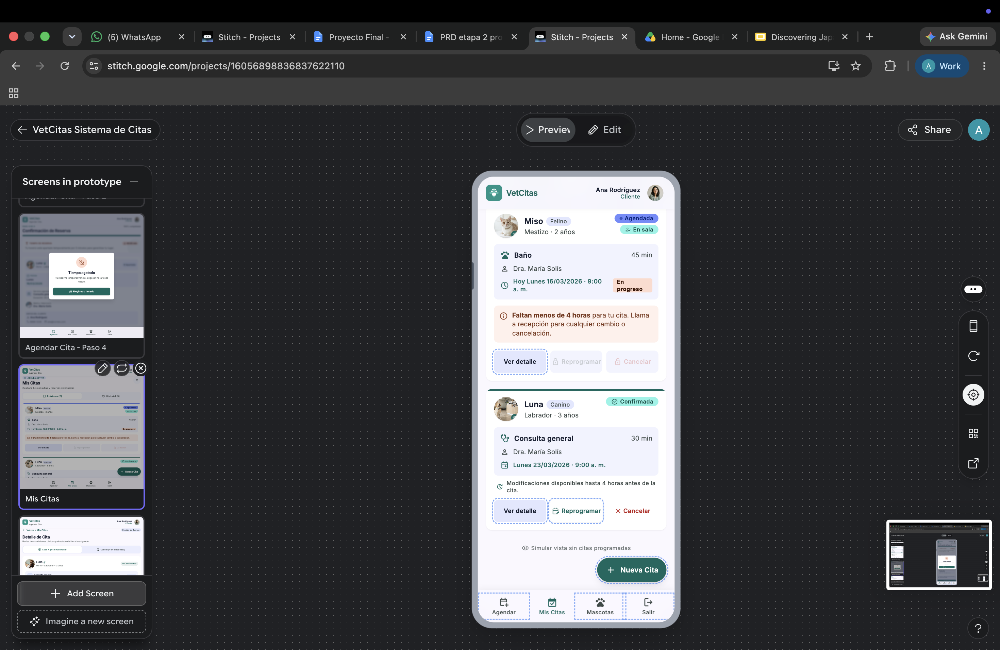 |
| 9 | Detalle de cita (caso A y caso B) | Cliente | P-06 | 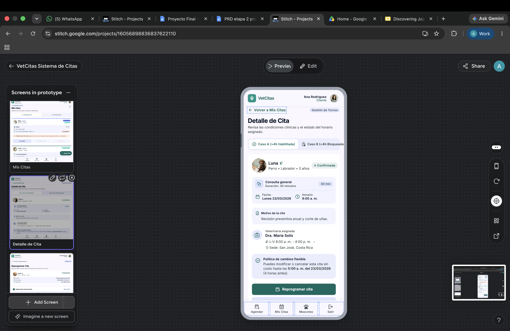 |
| 10 | Reprogramar cita | Cliente | P-07 | 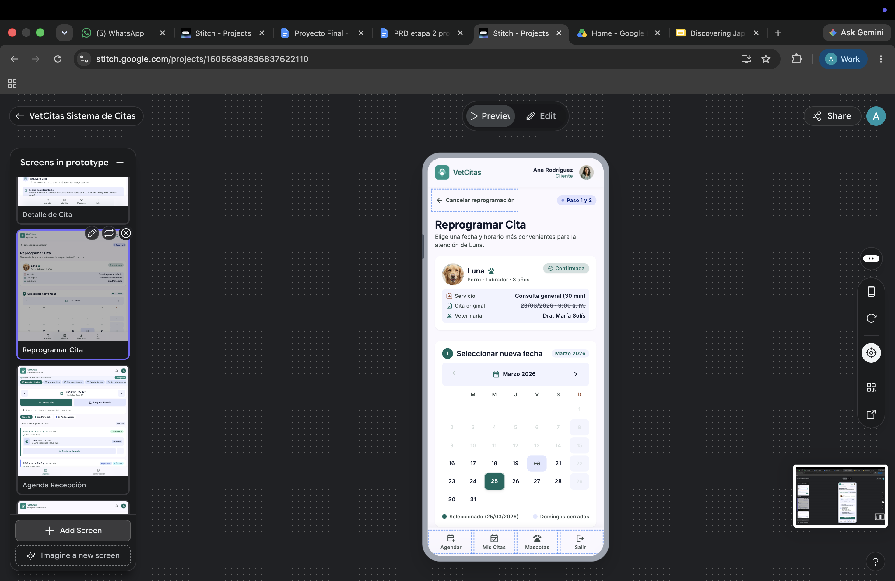 |
| 11 | Agenda de recepción | Secretaria | P-08, RF-04 | 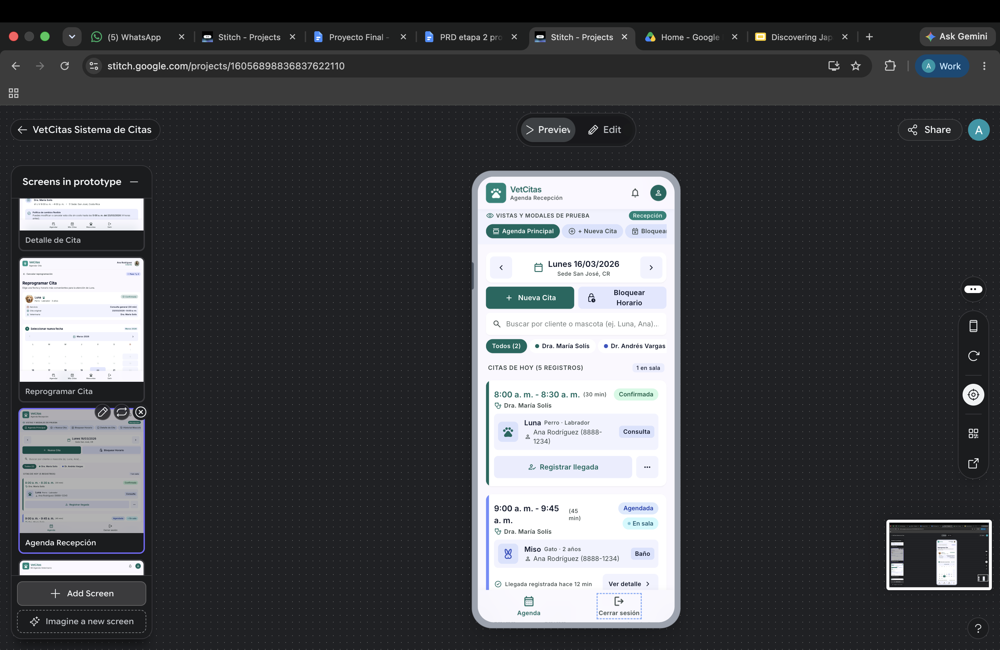 |
| 12 | Mi agenda (Marcar atendida solo con "En sala") | Veterinario | P-09, RG-13 | 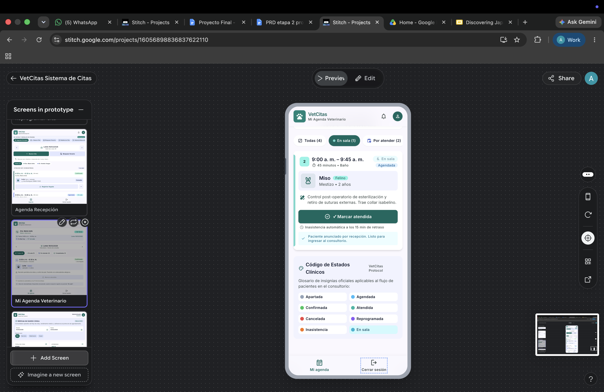 |
| 13 | Reportes | Administrador | P-11, RF-12 | 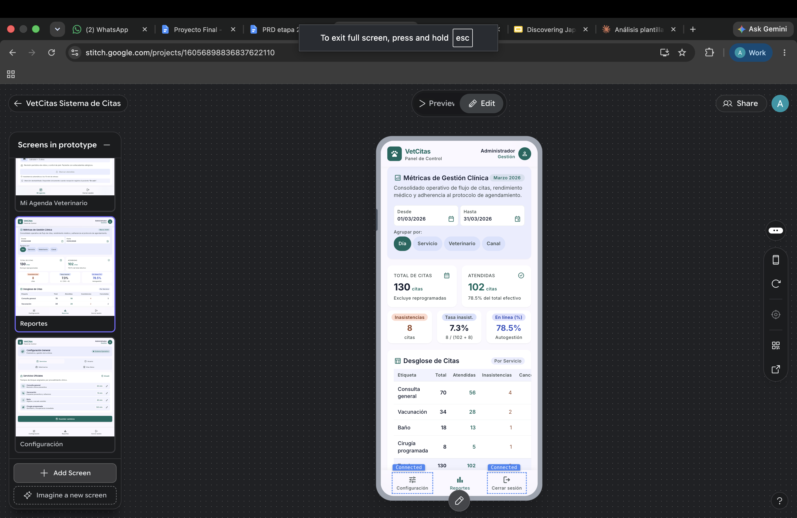 |
| 14 | Configuración | Administrador | P-10, RF-08 | 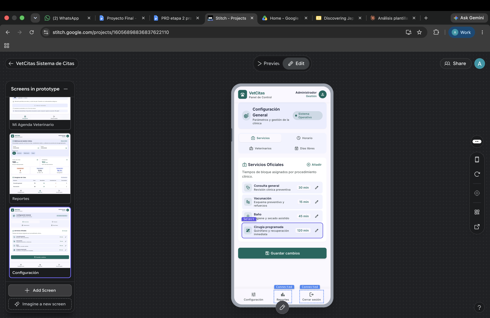 |

> Para que el enlace funcione al docente, el proyecto debe estar compartido con acceso por enlace (botón **Share** en Stitch).
